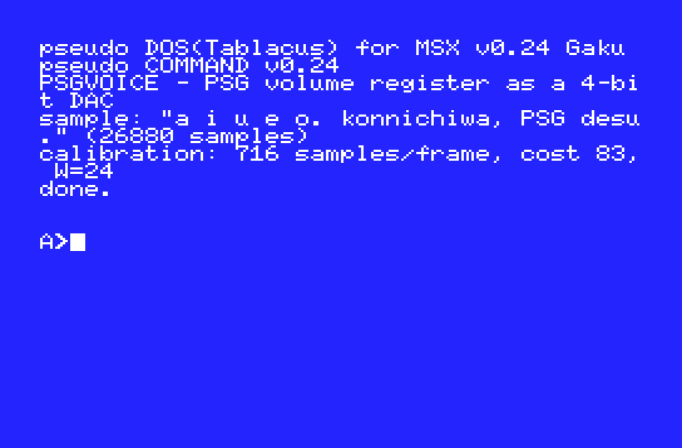

# psg-voice

[日本語](README.ja.md) | English



Explained in slides & C: playing voice on MSX1 by using the PSG (AY-3-8910) volume register as a 4-bit DAC. Based on Voich (KAKAO SOFT), "PSG de Onsei wo Saisei suru Shikumi" (KIRU! tech notes).

## Play in the browser

- [Play on WebMSX (ROM, MSX turboR)](https://webmsx.org/?MACHINE=MSXTRJ&P=NODISK&CARTRIDGE1_URL=https://raw.githubusercontent.com/renatus-xxxx/psg-voice/main/dist/PSGVOICE-LITE.ROM)

The ROM auto-boots into pseudo DOS (Ese-DOS / DISK ROM Lite) and runs
`PSGVOICE.COM` from AUTOEXEC.BAT. It calibrates itself, plays the sample
voice, prints the measured values, and returns to the `A>` prompt.

## What this is

- `slides/` — a 14-slide explanatory deck as PDFs in
  English ([psg-voice-explained.en.pdf](slides/psg-voice-explained.en.pdf)) and Japanese
  ([psg-voice-explained.ja.pdf](slides/psg-voice-explained.ja.pdf)): the DAC idea, the data pipeline,
  the 447-cycle budget, the wait-loop arithmetic, and startup calibration.
- `src/wav2psg.c` — PC tool (C99): WAV → peak normalise → resample to
  8000 Hz → ×4 gain + clip → quantise to PSG volume steps 0–15,
  emitting `voice_data.h`.
- `src/psgvoice.c` — MSX-DOS / Ese-DOS command `PSGVOICE.COM` (z88dk,
  inline assembler only for the cycle-counted playback loop).
- `sample/` — the bundled sample voice: "A i u e o. Konnichiwa, PSG
  desu." ([sample_voice.wav](sample/sample_voice.wav))
  AI-synthesised for this project in 2026; no third-party
  recording is used, so there is no copyright issue. Chosen because the
  five vowels plus a short greeting stay intelligible through 4-bit
  playback.
- `dist/` — built `PSGVOICE.COM` (35,096 bytes) and
  `PSGVOICE-LITE.ROM` (512 KB, DISK ROM Lite cartridge, ASCII 8K).

## Build

```sh
make -f Makefile.linux        # PSGVOICE.COM
make -f Makefile.linux rom    # + PSGVOICE-LITE.ROM (Ese-DOS)
```

Requires z88dk.
`tools/tablacus/` vendors Tablacus DISK ROM Lite (MIT, locally patched
build — see its README) for the ROM image.

PC tool (wav2psg; Windows / macOS / Ubuntu):

```sh
cmake -S . -B build
cmake --build build
```

## Calibration note

This sample counts VDP vertical-blank flags under DI instead of JIFFY:
on WebMSX the BIOS interrupt handler itself is expensive (its PSG I/O),
which biased a JIFFY-based measurement by ~22 cycles/sample in testing.
Details are in the comments of `src/psgvoice.c`.

## Credits

- Method and original article: Voich (KAKAO SOFT),
  "PSG de Onsei wo Saisei suru Shikumi — MSX1 de 'Munen…' wo
  Shaberaseru made —", MSX 'KIRU!' tech notes, (c) 2024-2026.
  https://voichworks.booth.pm/items/9205845
  This repository is an independent explanation and re-implementation;
  the article itself is not redistributed here.
- DISK ROM Lite / pseudo DOS: Gaku (Tablacus), MIT license.
